I'm a Computer Science student who likes building and operating software systems. I enjoy working across the stack, but my current focus is **backend engineering, real-time systems, infrastructure and voice AI**.

I like understanding what happens beneath the abstractions: how services communicate, how systems handle concurrency, where latency comes from, and how software behaves under failure. I learn by building, debugging, experimenting and contributing to real projects.

**[Vāk](https://github.com/PiyushRajDev/vak) is real-time multilingual voice.** Participants speak in their own languages while listeners hear translated speech in their preferred language, preserving the speaker's voice. Focus: real-time audio, speech-to-text, translation, text-to-speech and low-latency communication.

<table>
<tr>
<td width="50%" valign="top">

</td>
<td width="50%" valign="top">

</td>
</tr>
</table>

<picture>
  <source media="(prefers-color-scheme: dark)" srcset="./profile-3d-contrib/profile-night-green.svg">
  <source media="(prefers-color-scheme: light)" srcset="./profile-3d-contrib/profile-green.svg">
  
</picture>

[Portfolio](https://portfolio-raj-piyush.vercel.app/) · [GitHub](https://github.com/PiyushRajDev) · [Email](mailto:piyush.99045@gmail.com)
