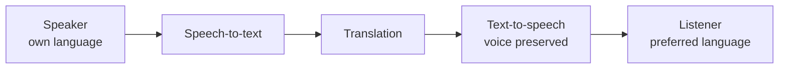

### Backend and real-time systems engineer

B.Tech CSE student (2027) at Chandigarh University. I build backend services and real-time voice systems, and I care about what happens beneath the abstractions: concurrency, latency and how software behaves under failure.

Open to backend, platform and software engineering roles.

### Now

- Building [Vāk](https://github.com/PiyushRajDev/vak), real-time multilingual voice communication
- Building [SkillLighthouse](https://github.com/PiyushRajDev/slh_demo), verified student talent beyond resumes
- Exploring low-latency audio pipelines, WebSockets, WebRTC and voice AI

### Projects

#### [Vāk](https://github.com/PiyushRajDev/vak): real-time multilingual voice

Participants speak in their own languages. Listeners hear translated speech in their preferred language, with the speaker's voice preserved.

Focus: real-time audio, speech-to-text, translation, text-to-speech and low-latency communication.

<!-- TODO: one concrete engineering detail here (latency target and what you measured, how you handle backpressure or dropped audio, why you chose the transport) -->

#### [SkillLighthouse](https://github.com/PiyushRajDev/slh_demo): verified student talent beyond resumes

Brings coding activity, interview preparation and skill assessments into one place, so students can show verified skills instead of claims.

`TypeScript` `PostgreSQL` `Redis` `background jobs` `AI-powered interviews`

<!-- TODO: one concrete detail (how verification works, queue design, scale you tested at) -->

#### [OASIX](https://github.com/PiyushRajDev/Oasix): marketing intelligence ([oasix.in](https://oasix.in))

Helps brands understand content distribution, discover trends, analyze sentiment and find opportunities across social platforms.

`SaaS` `AI-powered workflows`

### Stack

| | |
|---|---|
| **Languages** | C++, Python, TypeScript, JavaScript, Go |
| **Backend** | Node.js, Express, FastAPI |
| **Frontend** | React, Next.js |
| **Data** | PostgreSQL, Redis, MongoDB |
| **Infrastructure** | Docker, Kubernetes, AWS, Jenkins, Linux, Git |

### Contact

[piyush.99045@gmail.com](mailto:piyush.99045@gmail.com) · [Portfolio](https://portfolio-raj-piyush.vercel.app/)
