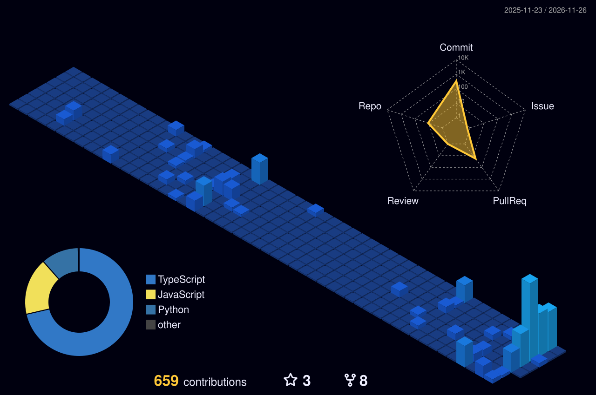

  

## `~/now`

| | |
|---|---|
| 🔨 **Building** | [SkillLighthouse](https://github.com/PiyushRajDev/slh), a live dashboard of verified student talent that replaces resumes |
| 🎙️ **Exploring** | Real-time audio and AI voice: latency, streaming, and the infra that keeps it reliable |
| 🧠 **Background** | Competitive programming (C++ / DSA) that grew into full-stack and backend engineering |
| 🎯 **Looking for** | Software engineering internships, ideally on backend or real-time products |
| 📫 **Reach me** | piyush.99045@gmail.com |

## `~/projects`

| Project | What it does | Stack | Links |
|---|---|---|---|
| **SkillLighthouse (SLH)** | Replaces resumes with a live dashboard of verified student talent, giving recruiters data-driven proof and students a way to stand out in placements. | TypeScript, React | [Code](https://github.com/PiyushRajDev/slh) · [Demo repo](https://github.com/PiyushRajDev/slh_demo) |
| **Trendy (StyleSense)** | [one-line description: what it does, for whom] | [stack] | [Code](https://github.com/PiyushRajDev/REPO_NAME) |
| **Metaspace** | [one-line description: what it does, for whom] | [stack] | [Code](https://github.com/PiyushRajDev/REPO_NAME) |

## `~/stack`

 
 

<!--
## `~/competitive-programming`
Uncomment this block and swap in your handles. Delete it if you'd rather not show ratings.

  
  

-->

## `~/activity`

<!-- Generated by the 3d-contrib.yml workflow. Shows contributions as 3D bars plus a radar chart and language donut. -->
<picture>
  
</picture>

 

