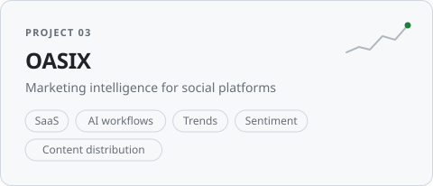

<picture>
  <source media="(prefers-color-scheme: dark)" srcset="./assets/hero-dark.svg">
  <source media="(prefers-color-scheme: light)" srcset="./assets/hero-light.svg">
  
</picture>

I build real-time backend systems. Right now that means **Vāk**, a live voice room where everyone speaks their own language and hears everyone else in theirs. I care about where latency comes from, how services behave under load, and what breaks first.

<picture>
  <source media="(prefers-color-scheme: dark)" srcset="./assets/wave-divider-dark.svg">
  <source media="(prefers-color-scheme: light)" srcset="./assets/wave-divider-light.svg">
  
</picture>

## Vāk

<picture>
  <source media="(prefers-color-scheme: dark)" srcset="./assets/vak-pipeline-dark.svg">
  <source media="(prefers-color-scheme: light)" srcset="./assets/vak-pipeline-light.svg">
  
</picture>

Real-time multilingual voice rooms. Each participant speaks in their own language; Vāk transcribes, translates and speaks it back to every listener in theirs. Built on Gnani's Prisma (speech-to-text) and Timbre (text-to-speech) APIs, with a Vite frontend and a Node.js backend.

**[Live demo](https://vak-amber.vercel.app)** · **[Source](https://github.com/PiyushRajDev/vak)**

What I measured while building it:

- WebSocket TTS returned first audio in about **387 ms**.
- STT round trips on Prisma (pa-IN) took roughly **103–184 ms** server-side.
- Concurrent **REST** TTS requests hit a rate limit (429) at one active request, while **WebSocket** TTS ran two streams in parallel without it. So the room's audio path runs over WebSockets.

<picture>
  <source media="(prefers-color-scheme: dark)" srcset="./assets/wave-divider-dark.svg">
  <source media="(prefers-color-scheme: light)" srcset="./assets/wave-divider-light.svg">
  
</picture>

## Also built

<table>
<tr>
<td width="50%" valign="top">

<a href="https://github.com/PiyushRajDev/slh_demo">
<picture>
  <source media="(prefers-color-scheme: dark)" srcset="./assets/card-slh-dark.svg">
  <source media="(prefers-color-scheme: light)" srcset="./assets/card-slh-light.svg">
  
</picture>
</a>

**SkillLighthouse.** A developer evaluation platform that brings coding activity, interview preparation and skill assessments into one place, so skills are verified instead of just claimed on a resume.

</td>
<td width="50%" valign="top">

<a href="https://github.com/PiyushRajDev/Oasix">
<picture>
  <source media="(prefers-color-scheme: dark)" srcset="./assets/card-oasix-dark.svg">
  <source media="(prefers-color-scheme: light)" srcset="./assets/card-oasix-light.svg">
  
</picture>
</a>

**Oasix.** An autonomous marketing operator that finds Instagram Reels trend opportunities for a brand's market and acts on them. Starting with fashion brands in India. [oasix.in](https://oasix.in)

</td>
</tr>
</table>

<picture>
  <source media="(prefers-color-scheme: dark)" srcset="./assets/wave-divider-dark.svg">
  <source media="(prefers-color-scheme: light)" srcset="./assets/wave-divider-light.svg">
  
</picture>

## Stack

| | |
|---|---|
| **Languages** | TypeScript, JavaScript, Python |
| **Backend** | Node.js, Express, FastAPI, PostgreSQL, Prisma, MongoDB |
| **Frontend** | React, Next.js, Vite |
| **Infra and tooling** | Docker, GitHub Actions, Jenkins, Turborepo, Linux, Git |
| **Real-time** | WebSockets, streaming audio pipelines |

## Contact

[piyush.99045@gmail.com](mailto:piyush.99045@gmail.com) · [Portfolio](https://portfolio-raj-piyush.vercel.app/) · [Oasix](https://oasix.in) · [GitHub](https://github.com/PiyushRajDev)
