  

  <strong>BACKEND SYSTEMS · REAL-TIME INFRASTRUCTURE · VOICE AI</strong>

I'm a Computer Science student at Chandigarh University (2027), building backend systems and real-time products. I care about what happens beneath the interface: transport, state transitions, latency budgets, failure modes and the engineering decisions that make systems reliable.

Source: [`tools/duel.py`](./tools/duel.py)

## Selected work

### [Vāk](https://github.com/PiyushRajDev/vak) · [Live demo](https://vak-amber.vercel.app/)

Real-time multilingual voice rooms. Everyone speaks their own language and hears other participants re-spoken in the language they chose, while original and translated captions keep the conversation visible.

- Streaming pipeline: microphone → Gnani Prisma speech recognition → translation → Gnani Timbre speech synthesis → listener playback.
- Node.js + WebSockets backend with a Vite/React frontend.
- Supports 10 Indian languages plus English.

  

### [OASIX](https://github.com/PiyushRajDev/Oasix) · [oasix.in](https://oasix.in)

An autonomous AI marketing operator that spots Instagram Reels trend opportunities for a brand's market and acts on them, starting with fashion brands in India.

### [SkillLighthouse](https://github.com/PiyushRajDev/slh_demo) · [Demo](https://slh-demo.vercel.app)

A proof-of-work platform for student developers. It brings projects, coding challenges, peer feedback and skill evidence together so hiring can look beyond resumes.

## Engineering interests

- Real-time audio and voice systems: streaming STT/TTS, WebSockets, WebRTC and low-latency pipelines
- Backend and distributed systems: concurrency, state management, queues, caching and failure handling
- Systems observability: tracing, latency analysis, debugging and performance measurement
- Building and shipping products end to end

## Stack

| Area | Tools |
|---|---|
| **Languages** | TypeScript, JavaScript, Go, Python, C++ |
| **Backend** | Node.js, Express, FastAPI |
| **Frontend** | React, Next.js |
| **Data** | PostgreSQL, Redis, MongoDB, Prisma |
| **Infrastructure** | Linux, Docker, Kubernetes, AWS, GitHub Actions, Jenkins |

## Contact

[Portfolio](https://piyushrajdev.github.io) · [Email](mailto:piyush.705039@gmail.com)

Open to backend, platform and software engineering roles.
