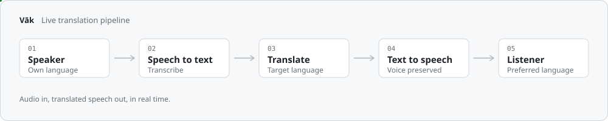
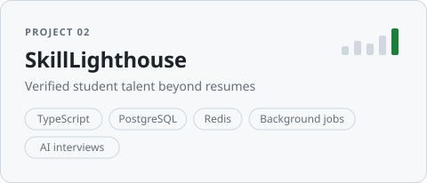
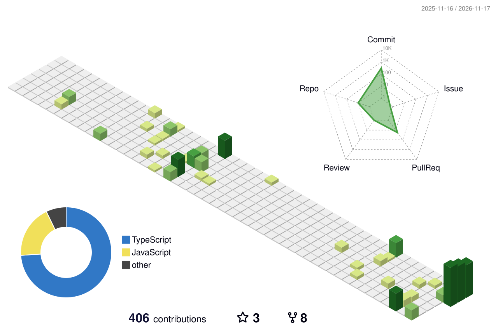

<picture>
  <source media="(prefers-color-scheme: dark)" srcset="./assets/hero-dark.svg">
  <source media="(prefers-color-scheme: light)" srcset="./assets/hero-light.svg">
  
</picture>

## About

I'm a Computer Science student who likes building and operating software systems. I enjoy working across the stack, but my current focus is **backend engineering, real-time systems, infrastructure and voice AI**.

I like understanding what happens beneath the abstractions: how services communicate, how systems handle concurrency, where latency comes from, and how software behaves under failure. I learn by building, debugging, experimenting and contributing to real projects.

## Currently

| | |
|---|---|
| **Building** | **Vāk**, multilingual real-time voice communication |
| **Building** | **SkillLighthouse**, verified student talent beyond resumes |
| **Exploring** | Low-latency audio pipelines, WebSockets, WebRTC and voice AI |
| **Engineering** | Backend architecture, distributed systems and infrastructure |
| **Looking for** | Backend, Platform, Real-Time and Software Engineering opportunities |

## Projects

<picture>
  <source media="(prefers-color-scheme: dark)" srcset="./assets/vak-pipeline-dark.svg">
  <source media="(prefers-color-scheme: light)" srcset="./assets/vak-pipeline-light.svg">
  
</picture>

**[Vāk](https://github.com/PiyushRajDev/vak): real-time multilingual voice.** Participants speak in their own languages while listeners hear translated speech in their preferred language, preserving the speaker's voice. Focus: real-time audio, speech-to-text, translation, text-to-speech and low-latency communication.

<table>
<tr>
<td width="50%" valign="top">

<a href="https://github.com/PiyushRajDev/slh_demo">
<picture>
  <source media="(prefers-color-scheme: dark)" srcset="./assets/card-slh-dark.svg">
  <source media="(prefers-color-scheme: light)" srcset="./assets/card-slh-light.svg">
  
</picture>
</a>

Helps students demonstrate verified skills beyond traditional resumes by bringing coding activity, interview preparation and skill assessments into one place.

</td>
<td width="50%" valign="top">

<a href="https://github.com/PiyushRajDev/Oasix">
<picture>
  <source media="(prefers-color-scheme: dark)" srcset="./assets/card-oasix-dark.svg">
  <source media="(prefers-color-scheme: light)" srcset="./assets/card-oasix-light.svg">
  
</picture>
</a>

Helps brands understand content distribution, discover trends, analyze sentiment and find opportunities across social platforms. [oasix.in](https://oasix.in)

</td>
</tr>
</table>

## Engineering interests

| Area | Focus |
|---|---|
| **Backend** | API design, databases, caching, queues and service architecture |
| **Real-time** | WebSockets, WebRTC, audio streaming and event-driven communication |
| **Infrastructure** | Linux, Docker, Kubernetes, CI/CD, observability and cloud deployment |
| **Distributed systems** | Concurrency, fault tolerance, reliability and system performance |
| **AI systems** | Voice pipelines, inference latency, evaluation and production AI infrastructure |

## Stack

| | |
|---|---|
| **Languages** | C++, Python, TypeScript, JavaScript, Go |
| **Backend and frameworks** | Node.js, Express, FastAPI, React, Next.js |
| **Data and infrastructure** | PostgreSQL, Redis, MongoDB, Docker, Kubernetes, AWS |
| **Tools** | Git, GitHub, Jenkins, Linux, VS Code |

## Activity

<picture>
  <source media="(prefers-color-scheme: dark)" srcset="./profile-3d-contrib/profile-night-green.svg">
  <source media="(prefers-color-scheme: light)" srcset="./profile-3d-contrib/profile-green.svg">
  
</picture>

## Contact

[piyush.99045@gmail.com](mailto:piyush.99045@gmail.com) · [Portfolio](https://portfolio-raj-piyush.vercel.app/) · [GitHub](https://github.com/PiyushRajDev)

> Understand the system. Build the thing. Measure what matters.
