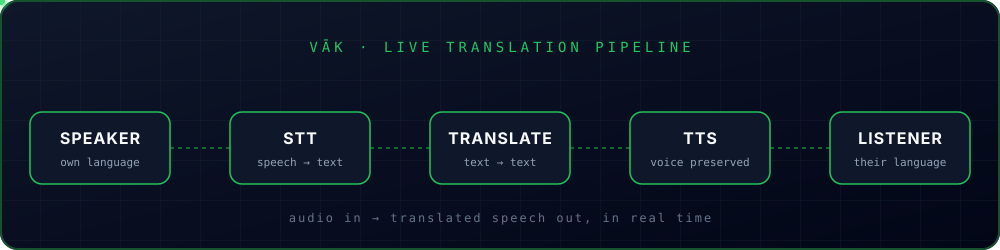
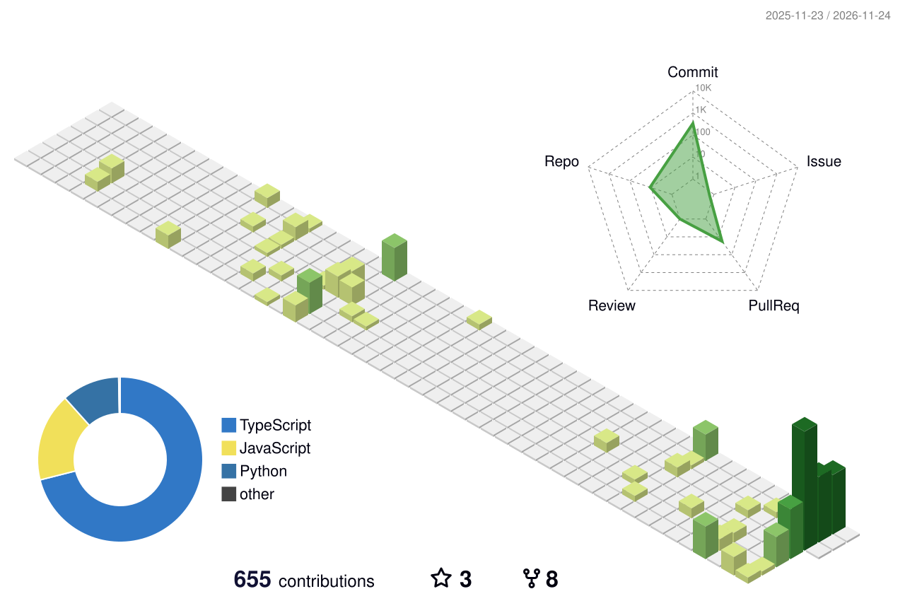

  

## `~/about`

> I'm a Computer Science student who likes building and operating software systems.

I enjoy working across the stack, but my current focus is **backend engineering, real-time systems, infrastructure, and voice AI**.

I like understanding what happens beneath the abstractions: how services communicate, how systems handle concurrency, where latency comes from, and how software behaves under failure.

I learn by building, debugging, experimenting, and contributing to real projects.

## `~/now`

| | Area | Current focus |
|---|---|---|
| 🔨 | **Building** | **SkillLighthouse**: verified student talent beyond resumes |
| 🎙️ | **Building** | **Vāk**: multilingual real-time voice communication |
| 📡 | **Exploring** | Low-latency audio pipelines, WebSockets, WebRTC and Voice AI |
| ⚙️ | **Engineering** | Backend architecture, distributed systems and infrastructure |
| 🎯 | **Looking for** | Backend, Platform, Real-Time and Software Engineering opportunities |

## `~/projects`

### 01. Vāk: Real-Time Multilingual Voice

  

A multilingual voice communication platform where participants speak in their own languages while listeners hear translated speech in their preferred language, preserving the speaker's voice.

**Focus:** Real-time audio, speech-to-text, translation, text-to-speech and low-latency communication.

 

<table>
<tr>
<td width="50%" valign="top">

### 02. SkillLighthouse

Helps students demonstrate verified skills beyond traditional resumes. It brings coding activity, interview preparation and skill assessments into one place.

**Focus:** Full-stack development, PostgreSQL, Redis, background jobs and AI-powered interviews.

</td>
<td width="50%" valign="top">

### 03. OASIX

A marketing intelligence product that helps brands understand content distribution, discover trends, analyze sentiment and find opportunities across social platforms.

**Focus:** SaaS development, AI-powered workflows and marketing intelligence. [Website](https://oasix.in)

</td>
</tr>
</table>

## `~/engineering`

| | Area | What I care about |
|---|---|---|
| 🧱 | **Backend** | API design, databases, caching, queues and service architecture |
| ⚡ | **Real-time** | WebSockets, WebRTC, audio streaming and event-driven communication |
| 🏗️ | **Infrastructure** | Linux, Docker, Kubernetes, CI/CD, observability and cloud deployment |
| 🔀 | **Distributed systems** | Concurrency, fault tolerance, reliability and system performance |
| 🤖 | **AI systems** | Voice pipelines, inference latency, evaluation and production AI infrastructure |

## `~/stack`

 
 
 

## `~/activity`

<!-- Made by the 3d-contrib.yml workflow: animated 3D contribution bars, radar chart and language donut -->

## `~/connect`

I'm interested in connecting with engineers, founders and teams building in backend infrastructure, developer tools, real-time communication and AI.

  

*"Understand the system. Build the thing. Measure what matters."*

